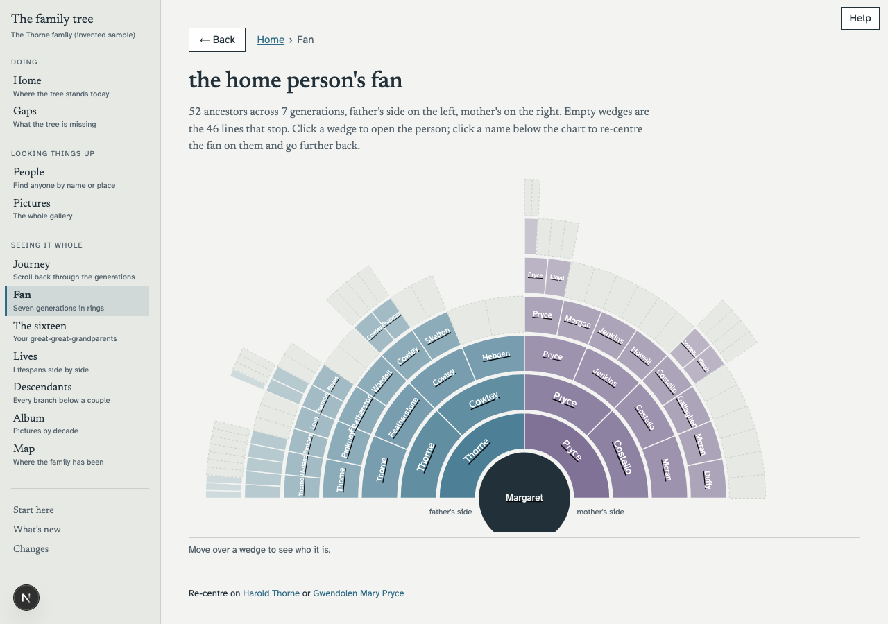
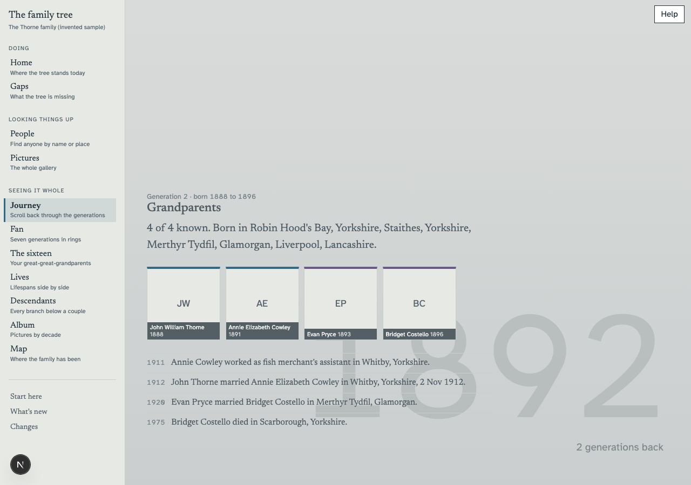
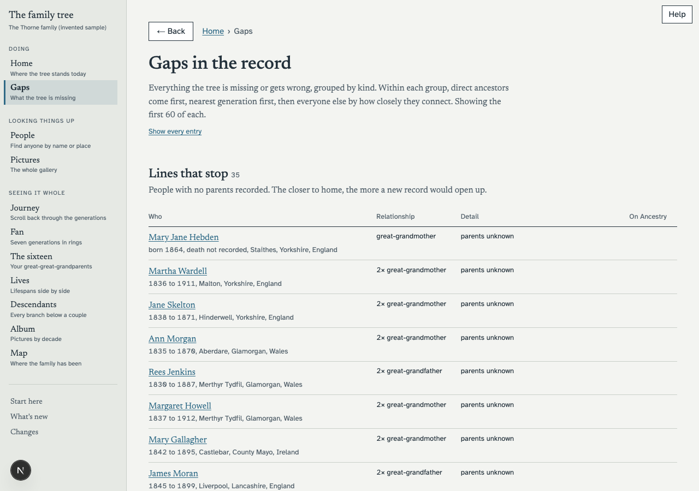
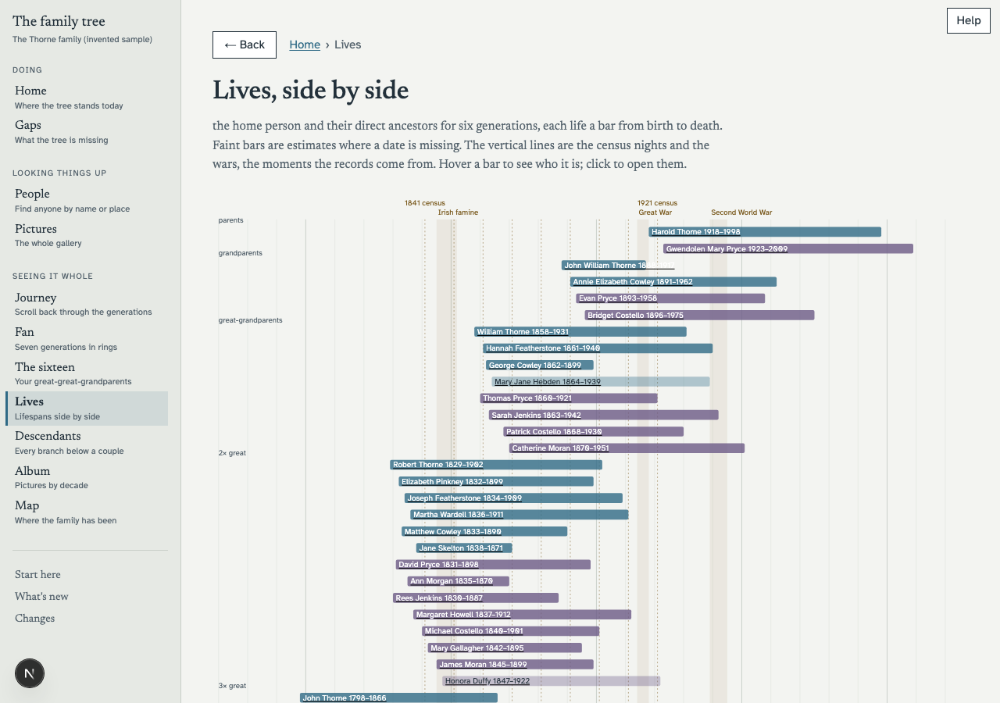

# family-tree-analysis

A family-history web app for one reader at a time. Import the GEDCOM export of your tree,
browse it, find the gaps worth researching next, and see the family in ways a genealogy site
cannot: a fan chart, a map that moves through time, lifespans against the census years, a
scroll back through the generations.



## Who it is for

It was built for one person: an 81-year-old who has spent twenty years on his family tree and
reads it on a laptop. Every design decision answers one question: can he use this without help?

So the type is large, the contrast is high, there are no small controls and no cards, the words
are plain, and nothing needs a second click to discover. Pages fall into two kinds. The working
pages (gaps, people, a person) exist so he can understand what the tree is missing and decide
what to look up next. The visual pages (journey, fan, the sixteen, lives, descendants, map)
exist to show what a genealogy site cannot draw.

If you look after a tree for a parent or a grandparent, this is for them. It is also perfectly
usable by anyone else.



## Quick start

```bash
git clone https://github.com/hurricaneworks/family-tree-analysis.git
cd family-tree-analysis
npm ci
npm run dev
```

Open http://localhost:4130. With nothing configured you get the invented sample family, so
every screen has something to show. Node 22.18 or later is required (we run 26);
the scripts use Node's own TypeScript support, which older 22.x releases only had behind a flag.

To use your own tree, put your export in `GEDCOM/` and run:

```bash
npm run import -- "GEDCOM/your-export.ged"
```

Then restart the dev server. Places on the map need coordinates: `node scripts/geocode.ts`
looks each one up on OpenStreetMap, one a second, and can be stopped and resumed. Set
`USER_AGENT_CONTACT` to an email address first, as Nominatim asks. `data/geocode.json` is a
cache keyed on the place string, so the sample's coordinates stay in it after you import and
are reused wherever your tree spells a place the same way; the geocoder only fetches the rest.

Nothing in `GEDCOM/` or `data/` is ever committed. The `.gitignore` sees to it.

## Getting your export

Every major genealogy site will give you your own tree as a GEDCOM file. It is plain text, and
it is the only way in to this app.

- **Ancestry**: open the tree, Tree Settings, then under Manage your tree choose Export tree
  and download the file.
- **MyHeritage**: Family tree, Manage trees, then Export to GEDCOM on the tree you want.
- **Findmypast**: open the tree, tree settings, Export tree.
- **FamilySearch**: the shared Family Tree cannot be exported directly. Desktop programs that
  sync with it (RootsMagic, Ancestral Quest and others) can write a GEDCOM of your branch.
- **Gramps** and most desktop programs: File, Export, GEDCOM.

**This app never logs in to a genealogy site and never will.** Those sites have no public API
for your tree and their terms forbid scripted access. The one supported input is an export
you make yourself, by hand, from your own account. Nothing you do here is written back
either; the app tells you what to change on the site and you make the change there.

## Getting your pictures

A GEDCOM export from Ancestry lists every picture in your gallery (title, type, who is in it)
but does not contain the images. The gallery pages have no download-all button. What we did,
and what the repo gives you, is a script you paste into your own browser while signed in:

1. Sign in to Ancestry and open your tree's gallery. The address looks like
   `https://www.ancestry.co.uk/family-tree/tree/<your tree id>/memories?sort=name`. Scroll to the
   very bottom so every item has loaded.
2. Open the browser's developer tools (Cmd+Option+J on a Mac, Ctrl+Shift+J elsewhere), paste the
   whole of `scripts/browser-fetch-photos.js` into the Console, and press Enter.
3. The browser asks once whether the site may download several files. Allow it.
4. Each picture lands in your Downloads folder as `<media id>.jpg`, plus a `manifest.json` listing
   them. Move them into `data/images/` in this project and run:

   ```bash
   node scripts/import-photos.ts data/images --local
   ```

   That matches each file to the export's media record and writes `data/photos.json`. Restart the
   dev server and the pictures appear on person pages, in the album and in the gallery.

The script fetches the pictures in your own gallery, one at a time with a pause between each,
once. It runs in your browser with your session; the app itself never touches the site. It asks
for a 2000-pixel version and falls back to the 500-pixel thumbnail if that is refused. Whether a
paste-in script sits within your provider's terms of use is a judgement for you; it is your
account and your uploads, and nothing here runs unattended.

Two optional steps follow, both needing `ANTHROPIC_API_KEY`: `scripts/classify-media.ts` sorts
the pictures into portraits, groups, documents and headstones (Ancestry's own labels are
unreliable), and `scripts/read-documents.ts` reads the certificates and headstones and checks
them against the tree. For a deployed site, `scripts/import-photos.ts` without `--local` also
uploads the images to a private Supabase Storage bucket.

## What it shows



- **Gaps**: lines that stop, missing births and deaths, people with no source, dates that do
  not add up, and probable duplicates, ranked with your direct ancestors first.
- **A person**: their family, every recorded fact with its sources, and what is missing.
  Each one has a printable page that saves as a PDF.
- **Compare**: two records side by side when the tree has someone twice.
- **Journey**, **fan**, **the sixteen**, **lives**, **descendants**, **album**, **map**: the
  visual views. Descendants colours each branch by the country it ended up in. Lives draws
  each life as a bar against the census nights and the wars.
- **Pictures** and **Who is this?**: the whole gallery, and the pictures nobody has named yet,
  with notes kept between visits once sign-in is on.
- **Changes**: what differs between one export and the next. **Log**: every merge and
  not-a-duplicate decision, with undo. **Start here**: the whole site explained on one page, for a first visit.



## People who may be living

A tree is full of living people, and a public tool must not publish their details without
their say. So by default anyone with no death recorded and a first known year within the
last hundred years has their dates, places, events, notes, other names and pictures withheld.
Their name and their place in the family still show, so the tree stays whole. A group
photograph with one such person in it is withheld entirely. The first known year comes from
the person's own facts and from their children's births, so a parent with no dates of their
own is judged by the children.

If the site is for your family only, behind sign-in, set `SHOW_LIVING_PEOPLE=true` in
`.env.local` and everything shows. The rule lives in `src/lib/privacy.ts` and is applied
once, when the tree is loaded, so every page, the printable life, the weekly digest and the
chat see the same withheld records.

## Turning on sign-in

Everything that remembers something (comments, My list, merge decisions, picture notes, the
weekly digest) needs a database, and the database brings sign-in with it. Steps:

1. Create a free project at [supabase.com](https://supabase.com). In Authentication, Sign In /
   Providers, turn **Allow new users to sign up** off: the only accounts are the ones you create.
2. Apply the schema. With the [Supabase CLI](https://supabase.com/docs/guides/cli) installed:

   ```bash
   supabase link --project-ref <your project ref>
   supabase db push
   ```

   That runs everything in `supabase/migrations/` in order. One of them schedules the weekly
   digest; before pushing, edit `20260909174613_digest_runs_and_weekly_cron.sql` and replace
   `https://example.invalid/api/digest` with your own site's address. Skip the edit if you do
   not want the digest: with no `digest_secret` in Vault the job posts nothing.
3. Put the project's URL, anon key and secret key in `.env.local` as `NEXT_PUBLIC_SUPABASE_URL`,
   `NEXT_PUBLIC_SUPABASE_ANON_KEY` and `SUPABASE_SECRET_KEY`, and list who may sign in, comma
   separated, in `ALLOWED_EMAILS`. An address not on that list is refused even with a valid password.
4. Create each login from your own machine (the script uses the secret key):

   ```bash
   USER_PASSWORD='choose one' node --env-file=.env.local scripts/create-user.ts you@example.com
   ```

   Run it again with a new password to reset one.
5. For the digest, also set `RESEND_API_KEY`, `MAIL_FROM`, `DIGEST_TO` and a long random
   `DIGEST_SECRET`, and store the same value in the Supabase dashboard under Project Settings,
   Vault, as a secret named `digest_secret`. The database calls `/api/digest` every Monday at
   07:00 UTC with that secret; the route refuses anything without it.

Under `npm run dev` only, `DEV_AUTH_BYPASS=true` skips the login page and signs you in as the
first address in `ALLOWED_EMAILS`. It does nothing on a production build.

## Putting it on the internet

The repo carries a `netlify.toml`, and any host that builds a Next.js app from git will do. Two
things are not obvious:

- **Configure sign-in first.** Without the database the site has no login at all, so a deployed
  copy would show your family to anyone with the address. Living people's details are withheld by
  default, but the dead are not, and the pictures are not.
- **Your tree is not in the repo, so the build has to fetch it.** `data/` and `GEDCOM/` are
  ignored by git (on purpose; see above), which means a hosted build starts empty and would
  otherwise import the sample family. Put your export somewhere private that the build can read
  with a URL only you know (a private Supabase Storage bucket with a long-lived signed URL, say),
  and set `TREE_GEDCOM_URL` to it in the host's environment. `scripts/ensure-data.ts` downloads and
  imports it before every build. Set `TREE_GEOCODE_URL` the same way, pointing at the
  `data/geocode.json` your local geocoding run produced, or the map has no pins. Both URLs are
  secrets: they lead to your family's records. Re-deploy after each new export.

The rest is environment: everything in `.env.example` goes into the host's settings, with
`SITE_URL` set to the real address so emailed links work. `next.config.ts` already tells the
build to ship `data/` with the server function; without that every page fails in production
while working locally.

## Optional features and what they cost

The tree, the gap report and every visual view work with nothing configured. Each feature
below needs a key, hides its own entry point when the key is missing, and is listed on the
home page with a line saying what it would do. `.env.example` documents every setting.

| Feature | Needs | What it costs |
|---|---|---|
| Sign-in, comments, My list, merge decisions | A free [Supabase](https://supabase.com) project; three keys | Nothing at this scale |
| Ask the tree: a question in plain words, answered from the records | `ANTHROPIC_API_KEY` | Roughly 5p to 30p a question, more for a long chain of lookups |
| Their world: a background note on the year and place someone was born | `ANTHROPIC_API_KEY` and the database | About a penny a person, once, then cached. `scripts/build-world.ts` writes them ahead of time so nobody waits |
| Replies to comments | `ANTHROPIC_API_KEY` and the database | Roughly 5p to 10p a comment |
| What the papers say: certificates and headstones read and checked against the tree | `ANTHROPIC_API_KEY`, the images, one run of `scripts/read-documents.ts` | Roughly 5p to 10p a document, once |
| Email: comment replies and the weekly digest | `RESEND_API_KEY` | Free tier covers a family |

The model figures are estimates at September 2026 prices for Claude Opus 5 and Sonnet 5;
check [Anthropic's pricing](https://www.anthropic.com/pricing) for the current rates. Each
model-backed route is metered per person per hour so a stuck browser tab cannot run up a
bill, and on a production build they refuse to run at all until sign-in is configured, so a
site left open on the internet cannot spend your key.

Without Supabase the site has no sign-in. That is fine on your own computer and wrong for
the open internet. The footer says so whenever it is the case.

## How it is put together

- `scripts/import.ts` reads a GEDCOM 5.5.1 file and writes JSON to `data/`. No dependencies;
  it runs on Node's own TypeScript support. This is probably the most reusable thing here.
- `src/lib/data.ts` loads the JSON once per process and indexes it: parents, generations from
  the home person, family links. `src/lib/gaps.ts` holds the gap rules. `src/lib/ancestry.ts`
  numbers ancestors the way genealogists do, and every visual view shares it.
- `src/app/` is a Next.js app: one folder per page.
- `samples/thorne-family.ged` is the invented family, 125 people across ten generations with
  faults left in on purpose. Nobody in it ever existed. See `samples/README.md`.

Family ids in a GEDCOM export are not stable between exports but person ids are, so families
are keyed on the spouse pair. Ancestry writes an empty death marker for anyone flagged
deceased, so a death record existing does not mean a death is known. There are more of these
in `CLAUDE.md`.

## Licence

MIT. See `LICENSE`.
